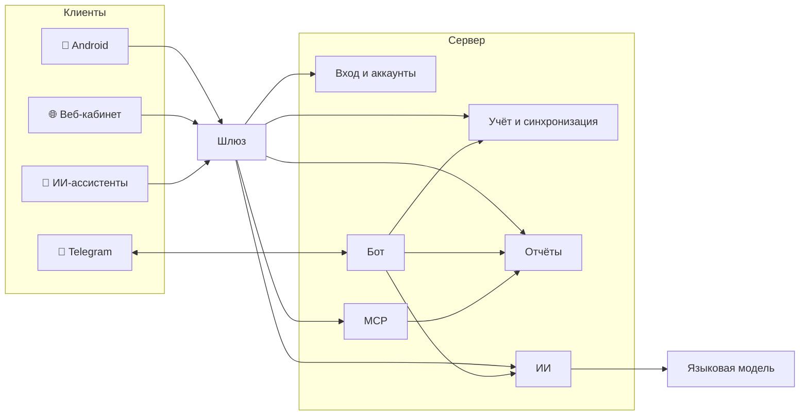

# Из чего состоит

Продукт — набор клиентов и собственный серверный стек из независимых
сервисов. Каждый сервис отвечает за одну функцию.

## Клиенты

| Компонент | Роль |
|---|---|
| **Android-приложение** | Основной клиент: полная база на устройстве, ввод, отчёты, курсы, ИИ, импорт выписок |
| **Веб-кабинет** | Аналитика, управление доступом, курсами, валютами, настройками и подключениями |
| **Telegram-бот** | Быстрый ввод трат, краткие отчёты и вопросы |

## Серверные сервисы

| Сервис | Функция |
|---|---|
| **Шлюз** | Единая точка входа: маршрутизирует запросы и проверяет пропуск пользователя |
| **Вход и аккаунты** | Вход через Google, сессии и устройства, роли, привязка Telegram, MCP-токены |
| **Учёт и синхронизация** | Хранит кошельки, категории и операции; принимает и раздаёт изменения устройствам; совместный доступ и приглашения; валюты, курсы и иконки |
| **Отчёты** | Все расчёты — остатки, обороты, структура, динамика, поиск. Только чтение |
| **ИИ** | Разбор трат и выписок, ответы на вопросы; единственный, кто обращается к языковой модели; ничего не записывает |
| **MCP-сервер** | Отдаёт ИИ-ассистентам инструменты кошелька, только чтение |
| **Бот** | Обрабатывает сообщения Telegram и действует от имени пользователя как ещё одно устройство |

## Принципы устройства

- **Запись и чтение разделены.** Пишет только сервис учёта, отчёты читают ту
  же базу ролью без права записи.
- **Пропуска выдаёт один сервис**, остальные проверяют их сами. Каждый
  сервис получает только те права, которые ему нужны.
- **Синхронизация пачками**: устройство отправляет свои изменения одной
  транзакцией и забирает чужие; повтор отправки ничего не дублирует.
- **Наблюдаемость**: метрики, журналы, версии и самоописание API у каждого
  сервиса.
