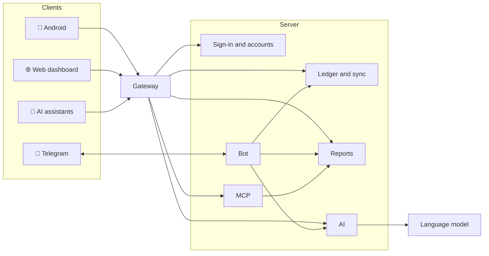

# Architecture

The product is a set of clients and its own server stack of independent
services. Each service is responsible for one function.

## Clients

| Component | Role |
|---|---|
| **Android app** | The main client: full database on the device, entry, reports, rates, AI, statement import |
| **Web dashboard** | Analytics, management of access, rates, currencies, settings and connections |
| **Telegram bot** | Quick expense entry, brief reports and questions |

## Server services

| Service | Function |
|---|---|
| **Gateway** | Single entry point: routes requests and checks the user's pass |
| **Sign-in and accounts** | Google sign-in, sessions and devices, roles, Telegram linking, MCP tokens |
| **Ledger and sync** | Stores wallets, categories and operations; accepts and distributes changes to devices; sharing and invitations; currencies, rates and icons |
| **Reports** | All calculations — balances, turnover, structure, trends, search. Read-only |
| **AI** | Parses expenses and statements, answers questions; the only component that talks to the language model; writes nothing |
| **MCP server** | Gives AI assistants wallet tools, read-only |
| **Bot** | Handles Telegram messages and acts on the user's behalf as one more device |

## Design principles

- **Writes and reads are separated.** Only the ledger service writes; reports
  read the same database with a role that cannot write.
- **One service issues passes**, the others verify them on their own. Each
  service gets only the rights it needs.
- **Batch sync**: a device sends its changes in one transaction and fetches
  everyone else's; resending never duplicates anything.
- **Observability**: metrics, logs, versions and self-describing APIs for
  every service.
