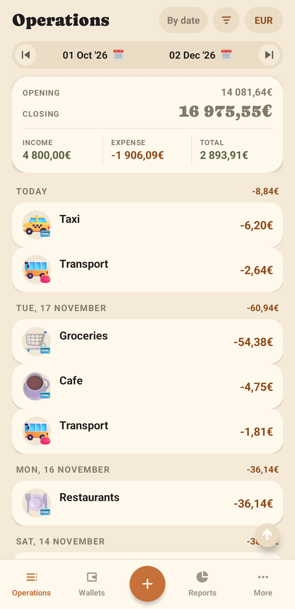
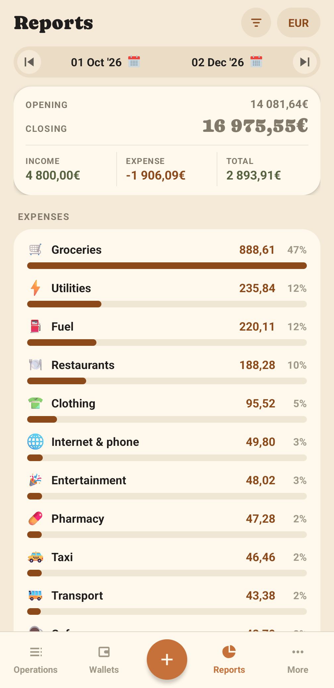
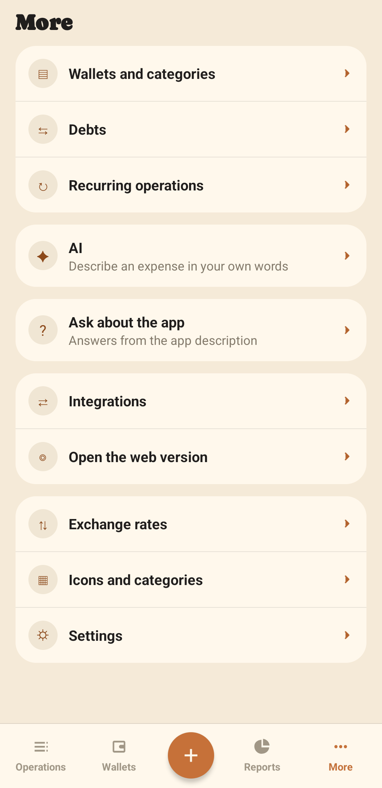
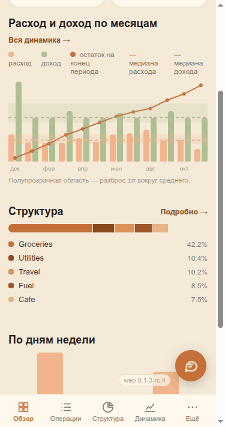
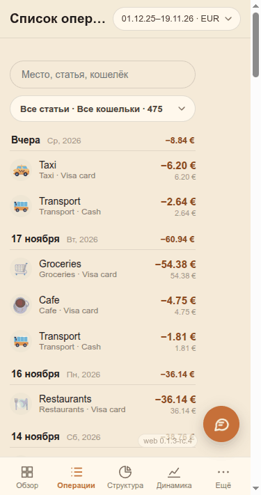

# What it looks like

The screenshots use demo data: two wallets and about a year of transactions with
seasonal spending. They contain no real amounts, names or addresses. Where to
get each client is on the [“Platforms”](platforms.md) page; what it is all made
of is in [“Architecture”](components.md).

=== "📱 Android"

    The app works offline and syncs in the background. The four screens of the
    bottom navigation:

    

    <figure style="max-width:240px;margin:0" markdown>
    { loading=lazy }
    <figcaption>Operations — the feed for the period and totals on top.</figcaption>
    </figure>

    <figure style="max-width:240px;margin:0" markdown>
    { loading=lazy }
    <figcaption>Wallets — the balance of each account.</figcaption>
    </figure>

    <figure style="max-width:240px;margin:0" markdown>
    { loading=lazy }
    <figcaption>Reports — where the money goes, by category.</figcaption>
    </figure>

    <figure style="max-width:240px;margin:0" markdown>
    { loading=lazy }
    <figcaption>More — reference lists, debts, rates and settings.</figcaption>
    </figure>

    

=== "🌐 Web dashboard"

    The web dashboard is adapted to phones: the same reports and the transaction
    list open in a browser with nothing to install. The screenshots are taken at
    a mobile width.

    

    <figure style="max-width:280px;margin:0" markdown>
    { loading=lazy }
    <figcaption>The spending report for a period.</figcaption>
    </figure>

    <figure style="max-width:280px;margin:0" markdown>
    { loading=lazy }
    <figcaption>The transaction list with search and filters.</figcaption>
    </figure>

    

=== "🧩 LM Studio"

    A local assistant answers a question about your money through MCP: the
    database does the sums, the model only retells the result. The question:
    *“How much did I spend on cafés in summer versus winter?”*

    <figure style="max-width:640px;margin:0 auto" markdown>
    { loading=lazy }
    <figcaption>LM Studio answers from your wallet data.</figcaption>
    </figure>

    How to connect it is in [“AI assistants (MCP)”](features/mcp.md). The path of
    an answer from the database to the assistant is on the
    [“How an answer gets from the database to the assistant”](components.md#mcp-answer)
    diagram.

=== "✨ Claude"

    The same question and the same answer, in Claude through the MCP connector.

    <figure style="max-width:640px;margin:0 auto" markdown>
    { loading=lazy }
    <figcaption>Claude answers from the same data.</figcaption>
    </figure>

    How to connect it is in [“AI assistants (MCP)”](features/mcp.md).
