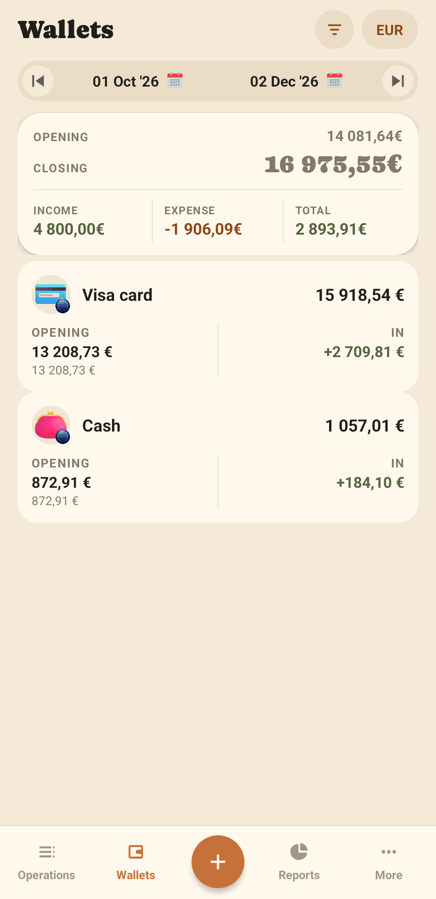
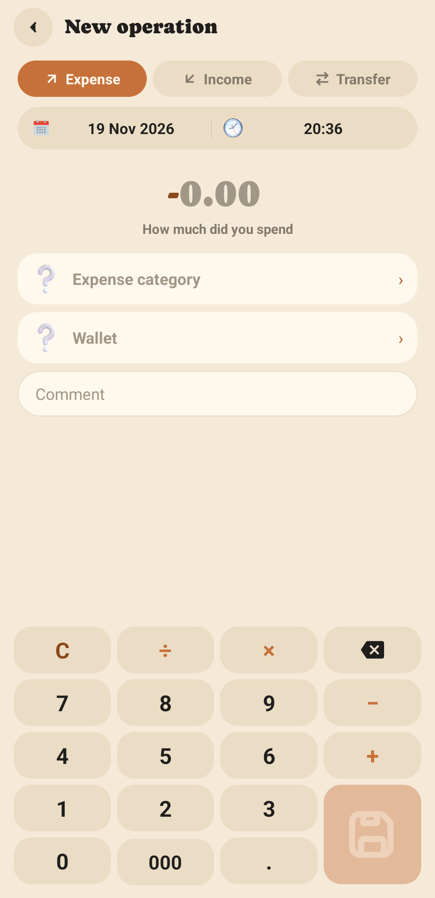
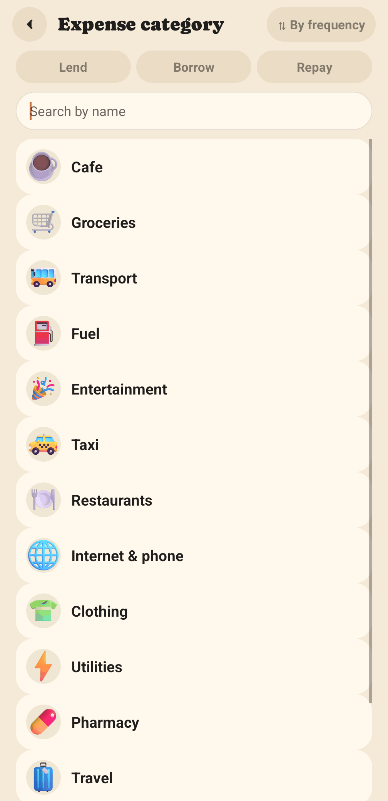
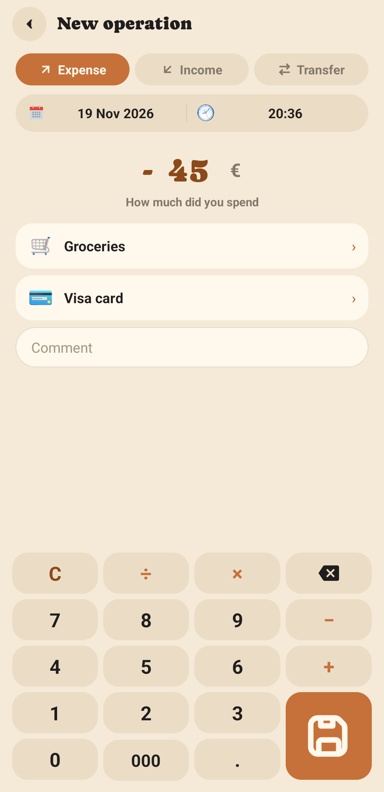
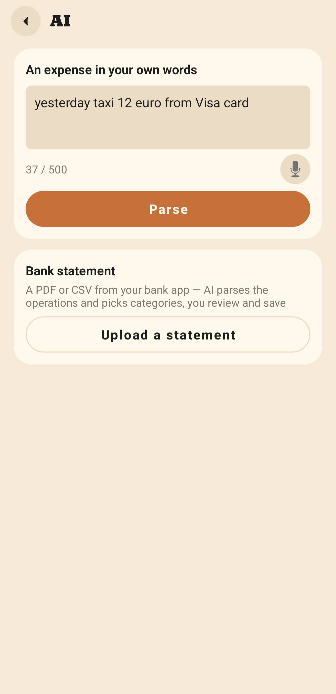
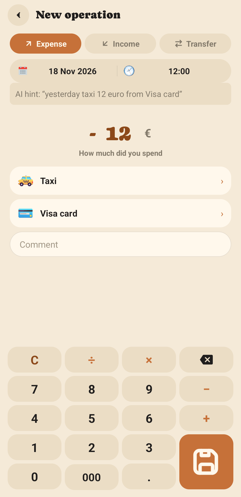
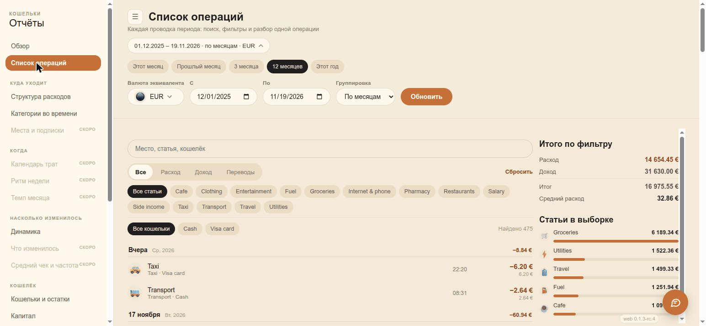
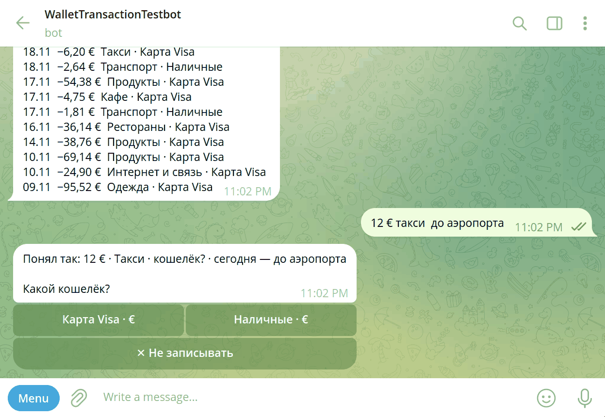

# What it looks like

The screenshots use demo data: two wallets and about a year of transactions with
seasonal spending. They contain no real amounts, names or addresses. Where to
get each client is on the [“Platforms”](platforms.md) page; what it is all made
of is in [“Architecture”](components.md).

=== "📱 Android"

    The app works offline and syncs in the background. The four screens of the
    bottom navigation:

    

    <figure style="max-width:240px;margin:0" markdown>
    { loading=lazy }
    <figcaption>Operations — the feed for the period and totals on top.</figcaption>
    </figure>
    <figure style="max-width:240px;margin:0" markdown>
    { loading=lazy }
    <figcaption>Wallets — the balance of each account.</figcaption>
    </figure>
    <figure style="max-width:240px;margin:0" markdown>
    { loading=lazy }
    <figcaption>Reports — where the money goes, by category.</figcaption>
    </figure>
    <figure style="max-width:240px;margin:0" markdown>
    { loading=lazy }
    <figcaption>More — reference lists, debts, rates and settings.</figcaption>
    </figure>

    

    Add a transaction
    { .showcase-h }

    The amount is typed on a built-in calculator keypad, then you pick a category and a wallet. Both can be searched by name.

    

    <figure style="max-width:200px;margin:0" markdown>
    { loading=lazy }
    <figcaption>New operation — expense, income or transfer.</figcaption>
    </figure>
    <figure style="max-width:200px;margin:0" markdown>
    { loading=lazy }
    <figcaption>Pick a category from the list or search by name.</figcaption>
    </figure>
    <figure style="max-width:200px;margin:0" markdown>
    { loading=lazy }
    <figcaption>Done — just tap Save.</figcaption>
    </figure>

    

    Add a transaction in your own words
    { .showcase-h }

    If tapping is a chore, write or dictate the expense: the AI parses it and fills in the same form. You save it yourself, the AI never writes to the wallet.

    

    <figure style="max-width:240px;margin:0" markdown>
    { loading=lazy }
    <figcaption>Write it the way you say it: “yesterday taxi 12 euro from Visa card”.</figcaption>
    </figure>
    <figure style="max-width:240px;margin:0" markdown>
    { loading=lazy }
    <figcaption>The AI fills in the form, you check it and save.</figcaption>
    </figure>

    

=== "🌐 Web dashboard"

    The web dashboard opens in any browser with nothing to install. On a computer
    it shows an overview with monthly dynamics and a transaction list with search,
    filters and a total for the selection.

    <figure style="max-width:100%;margin:0 0 1rem" markdown>
    { loading=lazy }
    <figcaption>Overview: spending, income and balance for a period, monthly dynamics.</figcaption>
    </figure>

    <figure style="max-width:100%;margin:0 0 1rem" markdown>
    { loading=lazy }
    <figcaption>Transaction list: search, category and wallet filters, a total for the selection.</figcaption>
    </figure>

    <figure style="max-width:100%;margin:0 0 1rem" markdown>
    { loading=lazy }
    <figcaption>Ask: a question about your spending in plain words. The assistant takes the figures from your own data — here €1,092.57 on cafes over a year, matching the total of the transaction list for the Cafe category. The question is asked in Russian.</figcaption>
    </figure>

    <figure style="max-width:100%;margin:0 0 1rem" markdown>
    { loading=lazy }
    <figcaption>Help: a question about how to use the app. The answer comes step by step, with button names as they appear on screen. The question and the interface are in Russian.</figcaption>
    </figure>

    On a phone
    { .showcase-h }

    The same dashboard is adapted to phones. The screenshots are taken at a mobile width.

    

    <figure style="max-width:280px;margin:0" markdown>
    { loading=lazy }
    <figcaption>The spending report for a period.</figcaption>
    </figure>
    <figure style="max-width:280px;margin:0" markdown>
    { loading=lazy }
    <figcaption>The transaction list with search and filters.</figcaption>
    </figure>

    

=== "💬 Telegram"

    The bot is one more “device” of yours: whatever you record in it shows up in the app and on the web right away. Write an expense in your own words, and if something is missing the bot asks with buttons. Nothing is saved until you confirm. The bot's replies here are in Russian, the language of the demo account.

    

    <figure style="max-width:420px;margin:0" markdown>
    { loading=lazy }
    <figcaption>“12 € taxi to the airport”: the bot got the amount and category and asks for the wallet.</figcaption>
    </figure>
    <figure style="max-width:420px;margin:0" markdown>
    { loading=lazy }
    <figcaption>The saved entry, a question about your data (“how much a month goes on cafés?”) and the <code>/wallets</code> command.</figcaption>
    </figure>

    

    More on the [Telegram bot](features/telegram.md) page.

=== "🧩 LM Studio"

    A local assistant answers a question about your money through MCP: the
    database does the sums, the model only retells the result. The question:
    *“How much did I spend on cafés over the last 12 months?”*

    <figure style="max-width:640px;margin:0 auto" markdown>
    { loading=lazy }
    <figcaption>LM Studio calls the tool and answers from your wallet data.</figcaption>
    </figure>

    How to connect it is in [“AI assistants (MCP)”](features/mcp.md).

=== "✨ Claude Code"

    The assistant answers a question about your money through MCP: the database does the sums, the model only retells the result. The question: *“How much did I spend on cafés over the last 12 months?”*

    <figure style="max-width:640px;margin:0 auto" markdown>
    { loading=lazy }
    <figcaption>Claude Code answers from your wallet data.</figcaption>
    </figure>

    The path of an answer from the database to the assistant is on the
    [“How an answer gets from the database to the assistant”](components.md#mcp-answer)
    diagram.

    How to connect it is in [“AI assistants (MCP)”](features/mcp.md).
