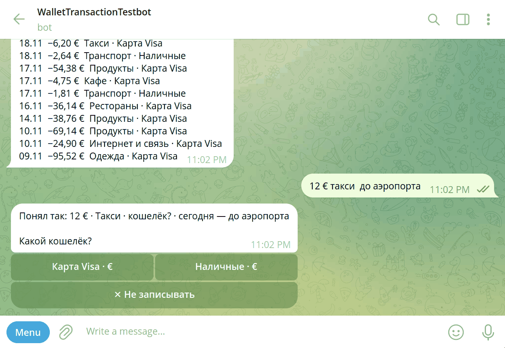
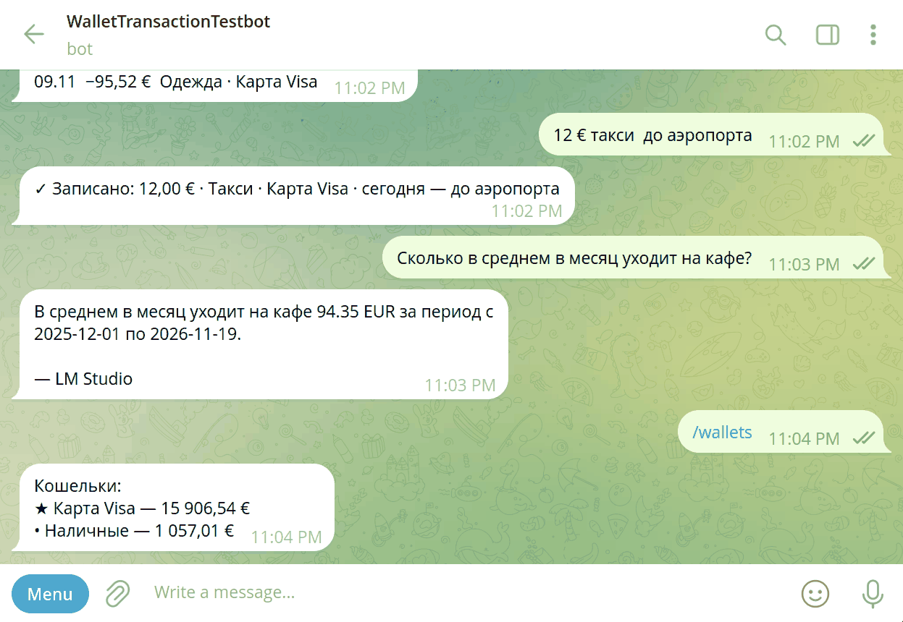

# Telegram-бот

Бот — ещё одно ваше «устройство»: всё, что вы в нём записали, сразу появляется
в приложении и на сайте.

## Подключение

В веб-кабинете на экране «Доступ и приглашения» получите одноразовый код и
отправьте его боту. Отключить можно в любой момент — из бота или с сайта.

## Ввод трат

- **Строгий формат** — одной строкой, работает всегда, даже без ИИ.
- **Своими словами** — «кофе 200», «вчера такси 450 с тинькоффа».
- Бот подбирает кошелёк и категорию, при неоднозначности спрашивает
  кнопками и показывает **карточку подтверждения**. Запись — только после
  нажатия.
- Повторное нажатие не создаёт дубль.

<figure style="max-width:420px;margin:0 auto" markdown>
{ loading=lazy }
<figcaption>Бот понял сумму и статью и спрашивает недостающее кнопками.</figcaption>
</figure>

## Команды

| Команда | Что делает |
|---|---|
| `/wallets` | Кошельки с остатками |
| `/categories` | Категории |
| `/last` | Последние операции |
| `/default` | Кошелёк по умолчанию |
| `/tz` | Часовой пояс |
| `/unlink` | Отключить бота |

## Вопросы

Спросите своими словами — бот ответит по данным кошелька и уточнит, если
вопрос неоднозначен. Модель — локальная или облачная, на ваш выбор.

<figure style="max-width:420px;margin:0 auto" markdown>
{ loading=lazy }
<figcaption>Вопрос по данным и команда <code>/wallets</code>.</figcaption>
</figure>
