# Как это выглядит

Кадры сняты на демо-данных: два кошелька и около года операций с сезонностью
расходов. Реальных сумм, имён и адресов на них нет. Где что установить —
на странице [«Где пользоваться»](platforms.md), из чего это всё состоит —
в разделе [«Из чего состоит»](components.md).

=== "📱 Android"

    Приложение работает без интернета, а синхронизация идёт в фоне. Четыре экрана
    нижней навигации:

    

    <figure style="max-width:240px;margin:0" markdown>
    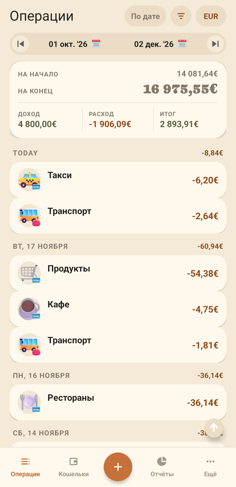{ loading=lazy }
    <figcaption>Операции — лента за период и итоги наверху.</figcaption>
    </figure>
    <figure style="max-width:240px;margin:0" markdown>
    { loading=lazy }
    <figcaption>Кошельки — остатки по каждому счёту.</figcaption>
    </figure>
    <figure style="max-width:240px;margin:0" markdown>
    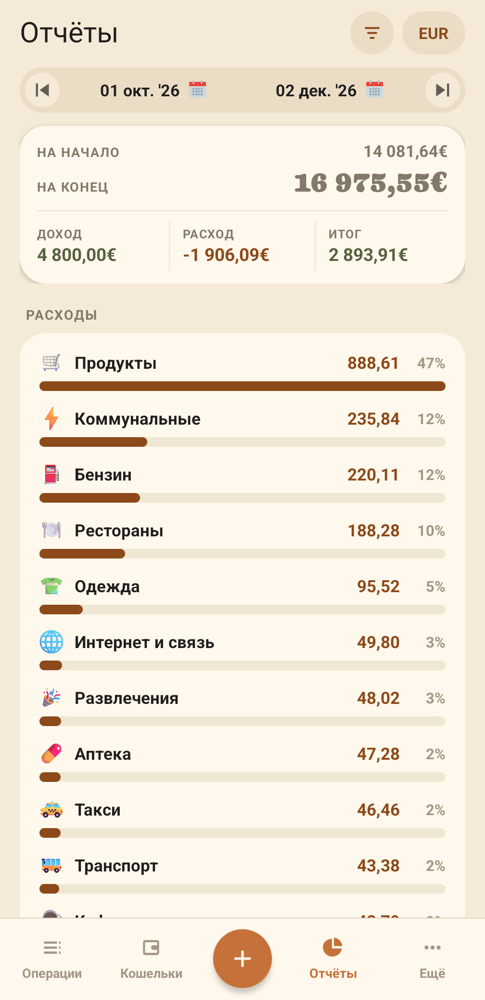{ loading=lazy }
    <figcaption>Отчёты — куда уходят деньги по категориям.</figcaption>
    </figure>
    <figure style="max-width:240px;margin:0" markdown>
    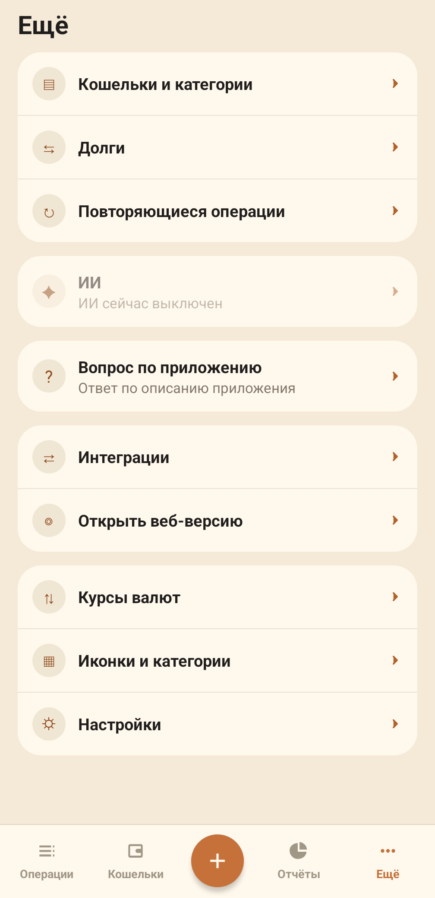{ loading=lazy }
    <figcaption>Ещё — справочники, долги, курсы и настройки.</figcaption>
    </figure>

    

    Добавить операцию
    { .showcase-h }

    Сумма набирается на встроенной клавиатуре с калькулятором, затем выбираются статья и кошелёк. Кошелёк и статью можно искать по названию.

    

    <figure style="max-width:200px;margin:0" markdown>
    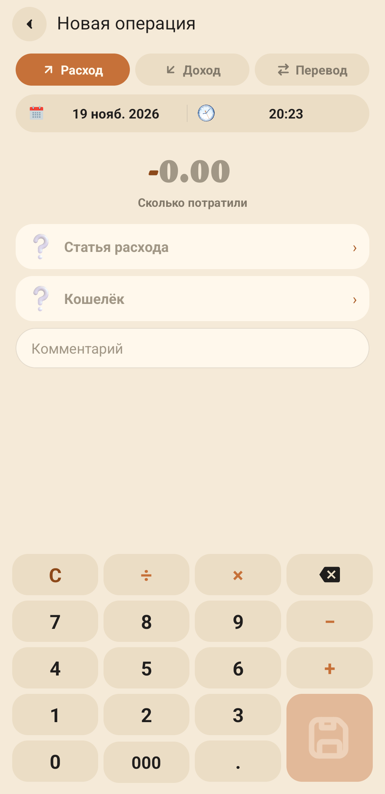{ loading=lazy }
    <figcaption>Новая операция — расход, доход или перевод.</figcaption>
    </figure>
    <figure style="max-width:200px;margin:0" markdown>
    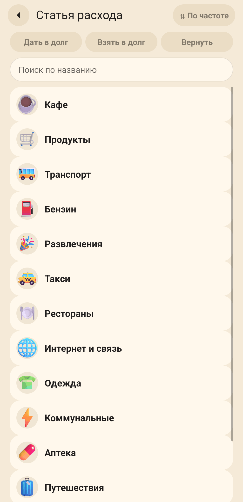{ loading=lazy }
    <figcaption>Статью выбирают из списка или ищут по названию.</figcaption>
    </figure>
    <figure style="max-width:200px;margin:0" markdown>
    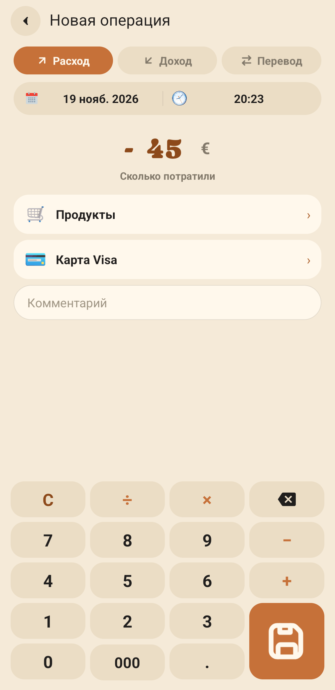{ loading=lazy }
    <figcaption>Готово — остаётся нажать «Сохранить».</figcaption>
    </figure>

    

    Добавить операцию словами
    { .showcase-h }

    Если лень нажимать, напишите или продиктуйте трату — ИИ разберёт её и заполнит ту же форму. Сохраняете вы сами, ИИ в кошелёк ничего не пишет.

    

    <figure style="max-width:240px;margin:0" markdown>
    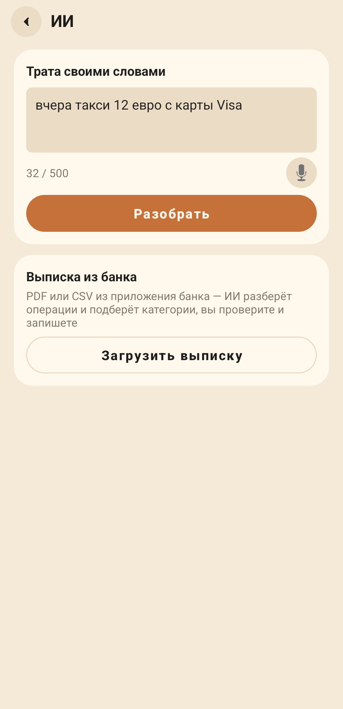{ loading=lazy }
    <figcaption>Напишите, как говорите: «вчера такси 12 евро с карты Visa».</figcaption>
    </figure>
    <figure style="max-width:240px;margin:0" markdown>
    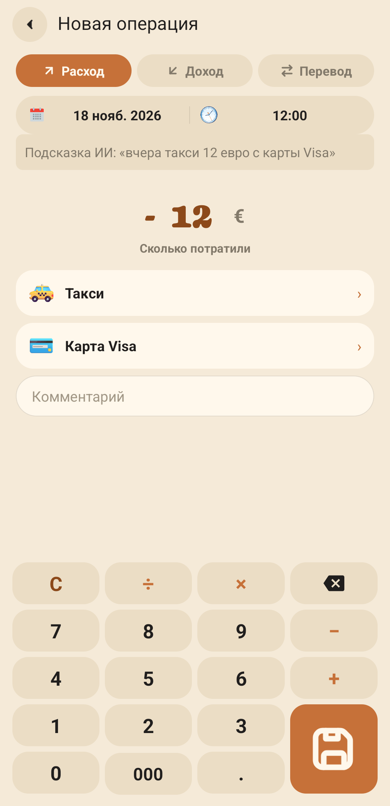{ loading=lazy }
    <figcaption>ИИ заполнил форму, вы проверяете и сохраняете.</figcaption>
    </figure>

    

=== "🌐 Веб-кабинет"

    Веб-кабинет открывается в любом браузере без установки. На компьютере — обзор
    с динамикой по месяцам и список операций с поиском, фильтрами и итогом по выборке.

    <figure style="max-width:100%;margin:0 0 1rem" markdown>
    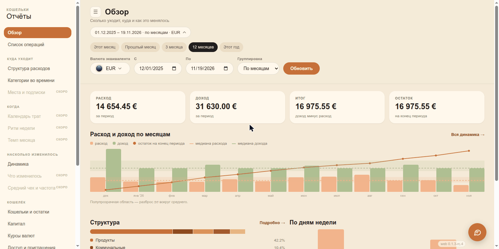{ loading=lazy }
    <figcaption>Обзор: расход, доход и остаток за период, динамика по месяцам.</figcaption>
    </figure>

    <figure style="max-width:100%;margin:0 0 1rem" markdown>
    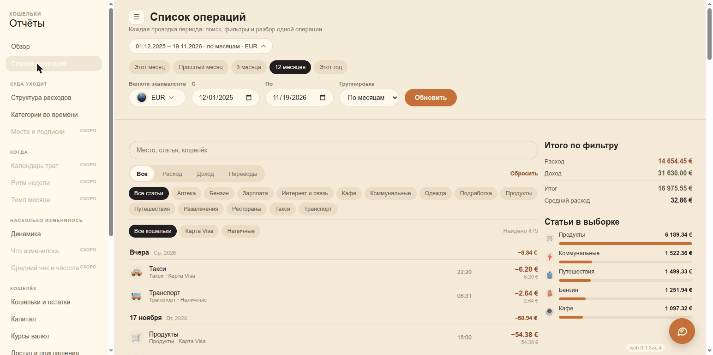{ loading=lazy }
    <figcaption>Список операций: поиск, фильтры по статьям и кошелькам, итог по выборке.</figcaption>
    </figure>

    <figure style="max-width:100%;margin:0 0 1rem" markdown>
    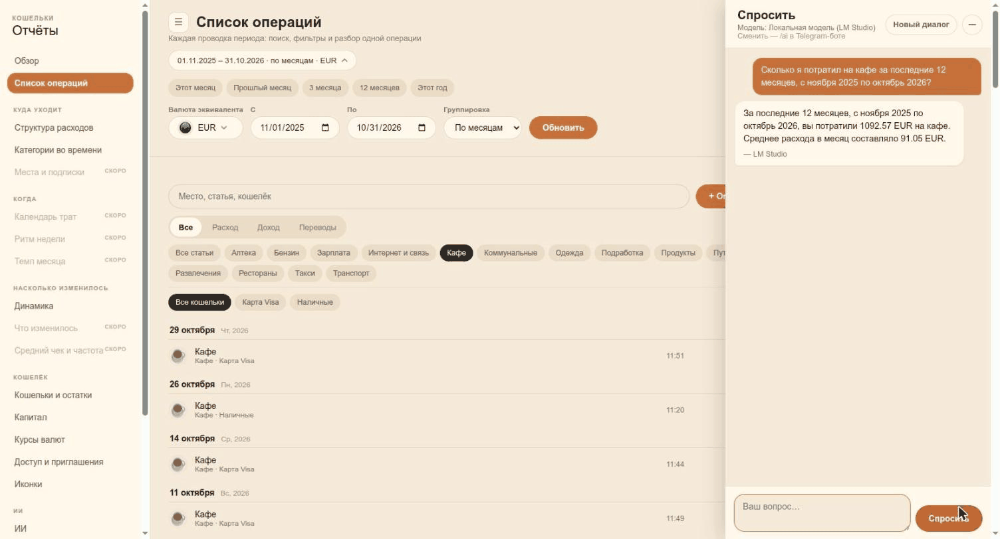{ loading=lazy }
    <figcaption>«Спросить»: вопрос о тратах словами. Ассистент берёт цифры из ваших данных — в примере 1 092,57 € на кафе за год, это совпадает с итогом списка операций по статье «Кафе».</figcaption>
    </figure>

    На телефоне
    { .showcase-h }

    Тот же кабинет адаптирован под телефон. Кадры сняты в мобильной ширине.

    

    <figure style="max-width:280px;margin:0" markdown>
    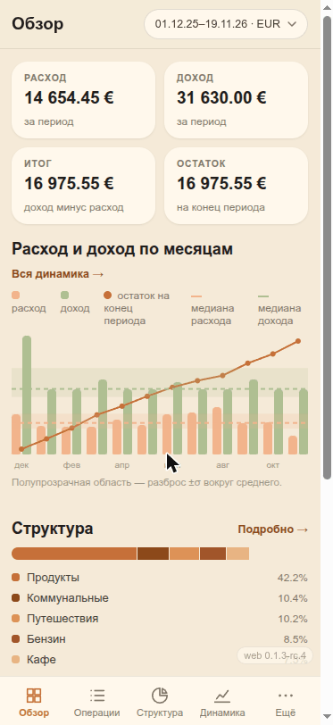{ loading=lazy }
    <figcaption>Отчёт по расходам за период.</figcaption>
    </figure>
    <figure style="max-width:280px;margin:0" markdown>
    { loading=lazy }
    <figcaption>Список операций с поиском и фильтрами.</figcaption>
    </figure>

    

=== "💬 Telegram"

    Бот — ещё одно ваше «устройство»: записанное в нём сразу видно в приложении и на сайте. Трату можно написать своими словами, а если чего-то не хватает, бот спросит кнопками. Запись — только после вашего подтверждения.

    

    <figure style="max-width:420px;margin:0" markdown>
    { loading=lazy }
    <figcaption>«12 € такси до аэропорта» — бот понял сумму и статью и спрашивает кошелёк.</figcaption>
    </figure>
    <figure style="max-width:420px;margin:0" markdown>
    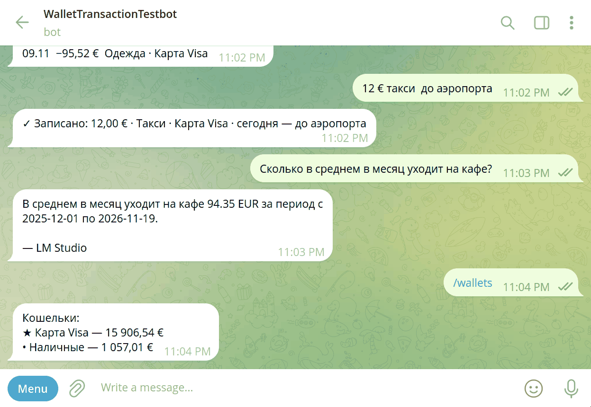{ loading=lazy }
    <figcaption>Запись, вопрос по данным («сколько в среднем в месяц уходит на кафе?») и команда <code>/wallets</code>.</figcaption>
    </figure>

    

    Подробнее — на странице [«Telegram-бот»](features/telegram.md).

=== "🧩 LM Studio"

    Локальный ассистент отвечает на вопрос о ваших деньгах через MCP: суммы
    считает база, модель только пересказывает результат. Вопрос: *«Сколько я тратил
    на кафе за последние 12 месяцев?»*

    <figure style="max-width:640px;margin:0 auto" markdown>
    { loading=lazy }
    <figcaption>LM Studio вызывает инструмент и отвечает по данным кошелька.</figcaption>
    </figure>

    Как подключить — в разделе [«Подключение ИИ-ассистентов (MCP)»](features/mcp.md).

=== "✨ Claude Code"

    Ассистент отвечает на вопрос о ваших деньгах через MCP: суммы считает база, модель только пересказывает результат. Вопрос: *«Сколько я тратил на кафе за последние 12 месяцев?»*

    <figure style="max-width:640px;margin:0 auto" markdown>
    { loading=lazy }
    <figcaption>Claude Code отвечает по данным кошелька.</figcaption>
    </figure>

    Путь ответа от базы до ассистента — на схеме
    [«Как ответ доходит из базы до ассистента»](components.md#mcp-answer).

    Как подключить — в разделе [«Подключение ИИ-ассистентов (MCP)»](features/mcp.md).
