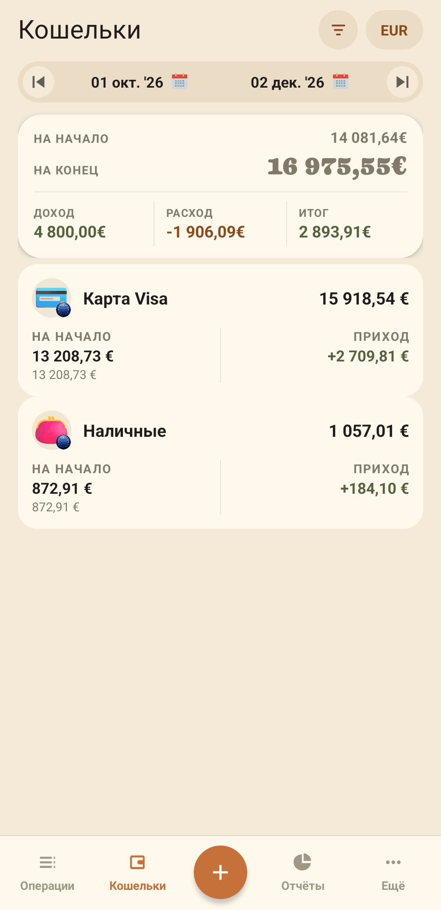
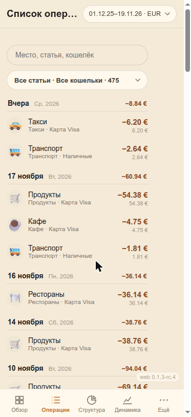
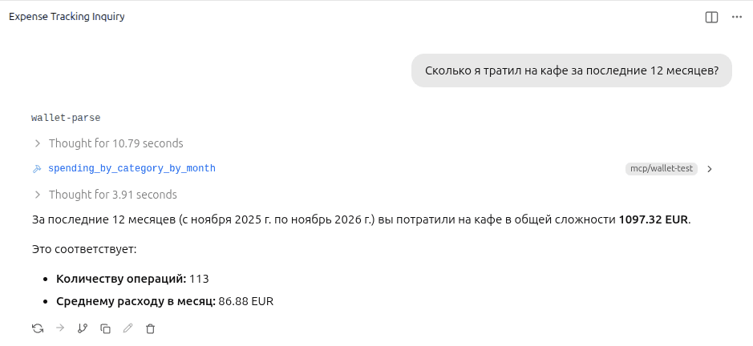
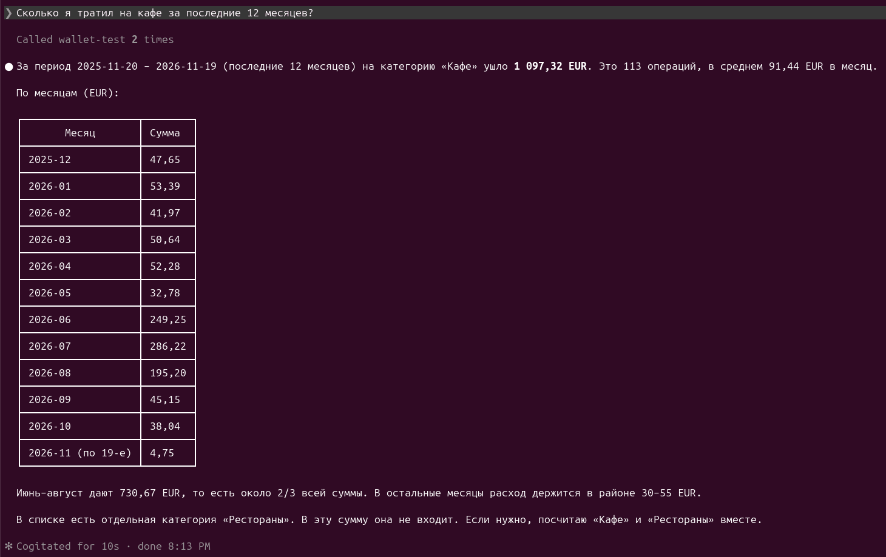

# Как это выглядит

Кадры сняты на демо-данных: два кошелька и около года операций с сезонностью
расходов. Реальных сумм, имён и адресов на них нет. Где что установить —
на странице [«Где пользоваться»](platforms.md), из чего это всё состоит —
в разделе [«Из чего состоит»](components.md).

=== "📱 Android"

    Приложение работает без интернета, а синхронизация идёт в фоне. Четыре экрана
    нижней навигации:

    

    <figure style="max-width:240px;margin:0" markdown>
    { loading=lazy }
    <figcaption>Операции — лента за период и итоги наверху.</figcaption>
    </figure>

    <figure style="max-width:240px;margin:0" markdown>
    { loading=lazy }
    <figcaption>Кошельки — остатки по каждому счёту.</figcaption>
    </figure>

    <figure style="max-width:240px;margin:0" markdown>
    { loading=lazy }
    <figcaption>Отчёты — куда уходят деньги по категориям.</figcaption>
    </figure>

    <figure style="max-width:240px;margin:0" markdown>
    { loading=lazy }
    <figcaption>Ещё — справочники, долги, курсы и настройки.</figcaption>
    </figure>

    

=== "🌐 Веб-кабинет"

    Веб-кабинет адаптирован под телефон: те же отчёты и список операций открываются
    в браузере без установки. Кадры сняты в мобильной ширине.

    

    <figure style="max-width:280px;margin:0" markdown>
    { loading=lazy }
    <figcaption>Отчёт по расходам за период.</figcaption>
    </figure>

    <figure style="max-width:280px;margin:0" markdown>
    { loading=lazy }
    <figcaption>Список операций с поиском и фильтрами.</figcaption>
    </figure>

    

=== "🧩 LM Studio"

    Локальный ассистент отвечает на вопрос о ваших деньгах через MCP: суммы
    считает база, модель только пересказывает результат. Вопрос: *«Сколько я тратил
    на кафе летом и сколько зимой?»*

    <figure style="max-width:640px;margin:0 auto" markdown>
    { loading=lazy }
    <figcaption>LM Studio отвечает по данным кошелька.</figcaption>
    </figure>

    Как подключить — в разделе [«Подключение ИИ-ассистентов (MCP)»](features/mcp.md).
    Путь ответа от базы до ассистента — на схеме
    [«Как ответ доходит из базы до ассистента»](components.md#mcp-answer).

=== "✨ Claude"

    Тот же вопрос, тот же ответ — в Claude через коннектор MCP.

    <figure style="max-width:640px;margin:0 auto" markdown>
    { loading=lazy }
    <figcaption>Claude отвечает по тем же данным.</figcaption>
    </figure>

    Как подключить — в разделе [«Подключение ИИ-ассистентов (MCP)»](features/mcp.md).
